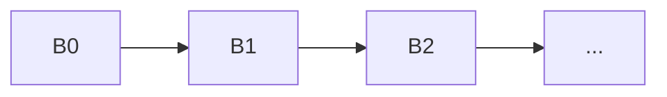
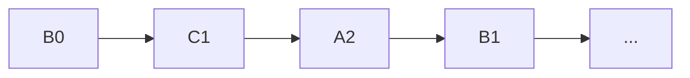

# LLM graphs with loops

## Introduction

This document has simple examples of LLM-graphs with cycles (or loops).

----

## Simplest, one-node loop with max-iterations

- Repetition is the simplest loop - it's achieved by self-reference.

- Once node state initialized, such a loop can be conceptually unrolled into a bounded sequence of passes.



- Initialization with "initial-value" element of the graph node spec.

```raku
use LLM::Graph;

my $refined = 
llm-graph({
        draft => sub ($topic, $field) {"Write a few sentence explanation of $topic for first-year undergraduate $field students." },
        refine => {           
            eval-function => sub ($refine) { "Improve this explanation to be clearer, more precise, and more concise:\n\n$refine" },
            initial-value => sub ($draft) { $draft },
            max-iterations => 3
        }
});

$refined.eval({ topic => "quantile regression", field => "mathematical fitting of bassis functions"})
```

---

## One-node loop with max-iterations and termination function


```raku
use JSON::Fast;

my $retry = 
llm-graph({
        json-record => {           
            eval-function => sub ($json-record) {
                "Extract the person's name and birth year from this text as a JSON object with keys \"name\" and \"year\". Reply with the JSON only.\n\n$json-record"
            },
            initial-value => sub ($text) { $text },
            termination-function => sub ($json-record) {
                my $h = Nil;
                try { $h = from-json($json-record) } 
                $h ~~ Map:D && $h.keys.sort eq <name year>
            },
            max-iterations => 3
        },
        parsed => sub ($json-record) { from-json($json-record) }
});

$retry.eval({text => 'Dimitar Savatinov is born in 1980 in Bulgaria.'})
```

---

##  Actor-Critic loop

- With multiple nodes loop, a starting point is needed.

- It can be "unrolled" once properly initialized:



- A loop is anchored when one node in the cycle provides the initial state and therefore determines where the first pass begins.

- The starting point (i.e. the loop anchor) is designated implicitly by providing initialization or other loop controls in its specifications.


```raku
my $actorCritic = llm-graph({
	draft => sub ($idea) { "Write a first draft of a short product description for $idea ."},
    	critique => sub ($refine) { 
            "Review this draft and list concrete problems:\n\n$refine\n\n" ~ 
            "If it needs no further work, reply with exactly APPROVED."
        },
    	refine => {
      		llm-function => "Improve this draft:\n\n$refine\n\nusing this critique:\n\n\$critique",
      		initial-value => sub ($draft) { $draft },
		termination-function => sub ($critique) { $critique ~~ Str:D && $critique.contains('APPROVED') },
      		max-iterations => 4
        }
    })

$actorCritic.eval({idea => 'electric scooter with one wheel'})
```

---

## Loop semantics

- A cyclic component has one anchor: the node with `initial-value` and `max-iterations`.
- `initial-value` runs once at the start of each graph evaluation. An explicitly supplied anchor value overrides it and becomes the initial state.
- Each iteration evaluates the other nodes in the component, then updates the anchor. A `termination-function`, when present, runs after that update.
- `max-iterations` counts anchor updates, not the initialization pass.
